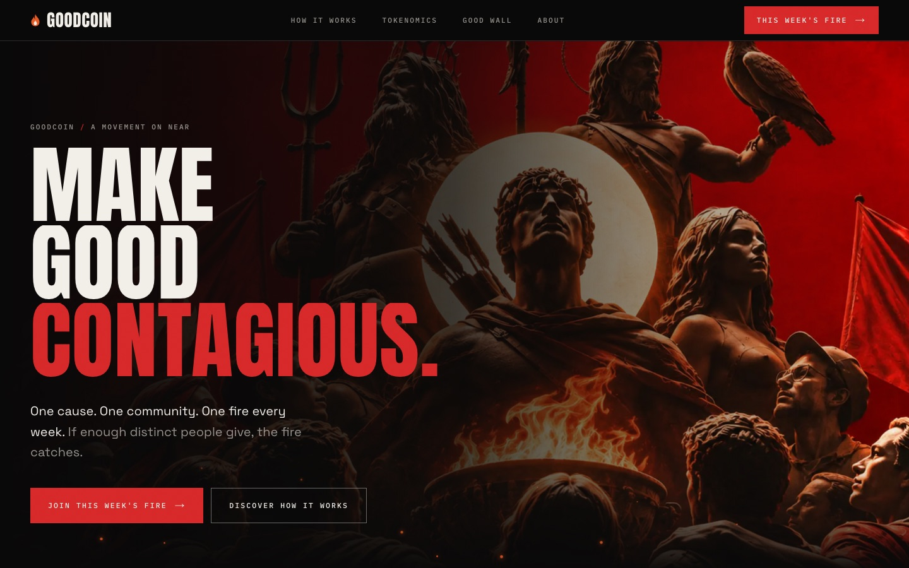
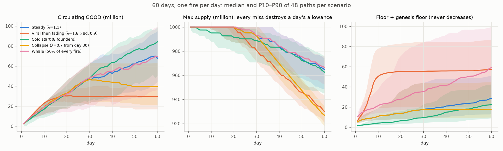
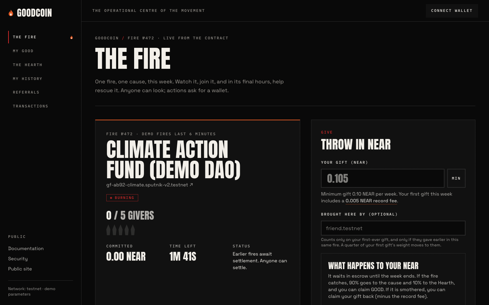
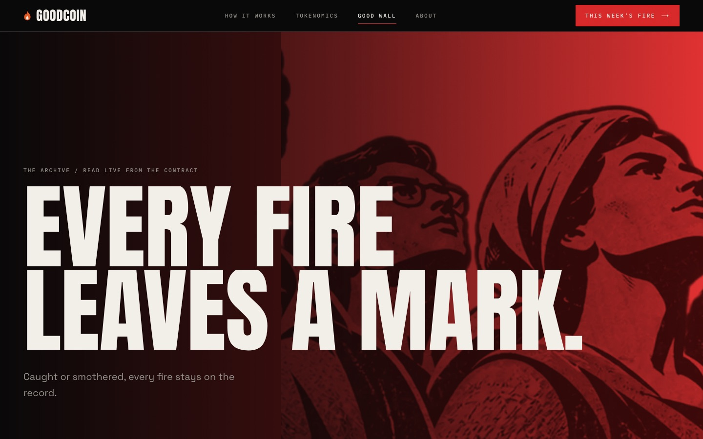

<div align="center">

# GOODCOIN

### A streak coin where the check-in is a gift.

**Memecoins coordinate millions of people to buy. GOODCOIN coordinates them to give together.**

[](#how-goodcoin-meets-the-brief)
[](https://testnet.nearblocks.io/address/goodfire-prod-ab92.testnet)
[](#contract-interface)
[](#verify-it-yourself-60-seconds-no-wallet)
[](#tests)
[](LICENSE)



</div>

## TL;DR

- **The check-in.** Each cycle there is one **fire** for one public good. A holder checks in by giving NEAR to it, once per account per fire.
- **Target hit.** If enough distinct accounts check in before the cycle ends, the fire **catches**:
  - every account that checked in gets newly minted GOOD;
  - 90% of the NEAR goes to the cause's DAO;
  - 10% goes into the **Hearth**, the reserve behind every GOOD;
  - the streak grows by one.
- **Target missed.** The fire is **smothered**:
  - every gift is refunded;
  - that cycle's GOOD is burned from the max supply forever;
  - the streak resets to zero.
- **The high score.** The longest streak is stored in the contract and printed on the token page.
- **On-chain only.** Everything above runs in one NEP-141 contract with no owner, no setters and no upgrade path. Both deployments have **zero access keys**, so nobody can switch it off or change a parameter.

| | |
|---|---|
| Production-parameter contract (7-day fires, goal 10) | [`goodfire-prod-ab92.testnet`](https://testnet.nearblocks.io/address/goodfire-prod-ab92.testnet) |
| Demo contract (same code, 6-minute fires, goal 4) | [`goodfire-demo4-ab92.testnet`](https://testnet.nearblocks.io/address/goodfire-demo4-ab92.testnet) |
| Causes (Sputnik DAO treasuries) | [`gf-ab92-oss.sputnik-v2.testnet`](https://testnet.nearblocks.io/address/gf-ab92-oss.sputnik-v2.testnet), [`gf-ab92-climate.sputnik-v2.testnet`](https://testnet.nearblocks.io/address/gf-ab92-climate.sputnik-v2.testnet) |
| 60-day simulation | [`sim/out/SIXTY_DAYS.md`](sim/out/SIXTY_DAYS.md) (supply under 5 scenarios plus a parameter sweep) |
| Full 5-year simulation | [`sim/out/REPORT.md`](sim/out/REPORT.md) (8 scenarios, 6 attacks, 3 sweeps) |
| Live testnet run | [8 steps, every rule exercised, links to every transaction](#live-run-on-testnet) |
| Fire factory | [`fires-ab92.testnet`](#anyone-can-light-a-fire): anyone launches a locked fire with the flagship's exact code |
| Real time | [Neon mirror + Realtime](#real-time): gifts, catches and burns stream to every page |

---

## How GOODCOIN meets the brief

The brief asks for a streak coin: holders check in, a shared target mints for those who showed up, a miss burns and resets the streak, and the longest streak becomes a public high score. GOODCOIN implements exactly that loop. The one change is what a check-in is: here it is a gift to a public good instead of a free click.

| Brief | GOODCOIN | Where |
|---|---|---|
| Holders check in once per cycle | `give(week, cause)`: one gift record per account per fire; repeat gifts top up the same record | [`fire.rs` `give`](contract/src/fire.rs#L16) |
| Community hits the check-in target | the fire's goal is a count of **distinct accounts**, not NEAR | [`fire.rs` `settle_one`](contract/src/fire.rs#L128) |
| Everyone who checked in gets a small mint | each giver's GOOD share is minted on `claim` as a NEP-141 `ft_mint` | [`claims.rs`](contract/src/claims.rs#L23) |
| Miss: a slice burns and the streak resets | that fire's GOOD allowance is burned from `max_supply`; streak → 0; gifts refunded | [`fire.rs` `smother`](contract/src/fire.rs#L200) |
| Longest streak printed like a high score | `streak` and `longest_streak` in contract state; shown on the fire page and the tokenomics page | [`fire.rs`](contract/src/fire.rs#L158), [`get_stats`](contract/src/views.rs#L107) |
| NEP-141, mechanic in the contract | one Rust contract: token, fire, Hearth, payouts, claims; NEP-141/145/148 + NEP-297 events | [`contract/src`](contract/src) |
| Parameters set at launch, readable by anyone, no admin key | `new(config)` is the only writer of `Config`; `get_config()` is public; no owner, no setters, no upgrade method; 0 access keys | [`lib.rs`](contract/src/lib.rs#L13) |
| Sybil resistance good enough for a demo, limits written plainly | every check-in costs at least `min_gift`, 90% of which reaches the cause; [limits below](#sybil-resistance-and-its-limits) | [`sim/out/REPORT.md`](sim/out/REPORT.md) |
| Page with current streak, today's progress, log of every mint and burn | `/app`: streak, longest streak, givers vs goal, countdown. `/good-wall`: every fire, caught or smothered, with its mint or burn. `/app/transactions`: your calls | [`web/`](web) |
| Simulate 60 days, supply over time, a few scenarios, then pick parameters | [`sim/out/SIXTY_DAYS.md`](sim/out/SIXTY_DAYS.md): 5 scenarios × 48 paths, then a 3×3 parameter sweep | [the 60-day simulation](#the-60-day-simulation) |

### Why a gift and not a free check-in

A free daily check-in that mints is a faucet. Sybil accounts cost almost nothing, so the streak measures how many accounts one person can script.

In GOODCOIN a check-in costs real NEAR, and 90% of it goes to a public good. That changes three things:

- **A fake check-in still pays the cause.** Each one costs ≥ 1 NEAR, and 0.9 of that reaches the cause.
- **The mint is never free.** Each new GOOD is paid for with at least 1.25× the current floor.
- **A miss costs nobody anything.** Every gift is refunded in full, minus a 0.005 NEAR storage fee.

So "the community kept the streak" means something: enough different accounts actually showed up and actually gave.

---

## The loop

```
 holders ──NEAR──► fire (escrow) ──── target: N distinct accounts ────► cycle ends · anyone calls settle()
                                               │
                     ┌─────────────────────────┴──────────────────────────┐
              target hit: CATCHES                                   target missed: SMOTHERED
              90% → cause DAO                                       every gift refunded
              10% → Hearth (backs GOOD)                             that cycle's GOOD burned from max supply
              GOOD minted to everyone who checked in                streak = 0
              streak + 1, longest_streak = max(...)                 next target eases ÷1.1
              next target grows ×1.1
```

**The target moves with the community.** The goal grows about 10% after every unaided catch and eases back by the same step after a miss. So a streak survives only if the circle keeps widening.

**The token has a floor.** Floor = Hearth NEAR ÷ backed GOOD, and anyone can `redeem` GOOD for its share of the Hearth at any time. Every catch adds NEAR to the Hearth at no less than 1.25× the floor, so the floor **can only go up**. The contract asserts this after every state change, and anyone can call `check_invariants()` to see it.

**Holders can save a streak.** In a fire's final moments, a holder can `kindle`: burn GOOD to lower the target by one when the fire is a giver short. The price doubles with every kindle in the same fire, and a rescued catch never raises the next target.

**Referrals.** A first-time giver can name an earlier giver of the same fire. A quarter of the newcomer's first-gift weight moves to that person. It is zero-sum, so it adds no new minting and cannot be farmed.

---

## The 60-day simulation

> *"Simulate 60 days of community behavior first and show me supply over time under a few scenarios. Then we pick the parameters."*

`cd sim && uv run python -m goodsim.sixty` takes about 3 seconds and is deterministic (seed `20261113`).

- **Fire length:** the simulation uses one fire per day, as in the brief.
- **Protocol:** every give, settle, claim, kindle and redeem runs through `goodsim.protocol`. This is an exact integer reference model of the contract. It is the same model that produces the golden trace the Rust tests replay, so the simulated supply is the supply the contract would produce.
- **Invariants:** the floor invariant is asserted after every operation of every path.



### Supply under five scenarios

Each scenario is 48 paths; values are medians. The parameters are the ones picked below.

| Scenario | Fires caught / 60 | Longest streak | Circulating day 15 / 30 / 60 (M GOOD) | Max supply day 60 (M) | Burned by misses (M) | Floor vs launch | NEAR to causes |
|---|---|---|---|---|---|---|---|
| Steady growth (λ = 1.1) | 45 | 23 | 27.1 / 46.6 / 67.9 | 964.8 | 35.2 | 28.7× | 22,928 |
| Viral, then fading (λ = 1.6 for 8 days, then 0.9) | 30 | 20 | 27.9 / 29.5 / 29.6 | 929.9 | 70.1 | 57.3× | 17,809 |
| Cold start (8 founders) | 44 | 23 | 25.4 / 47.7 / 84.1 | 962.6 | 37.4 | 22.3× | 18,208 |
| Collapse (λ = 0.7 from day 30) | 28 | 21 | 27.1 / 46.6 / 39.8 | 926.9 | 73.1 | 17.8× | 8,232 |
| Whale (50% of every fire) | 46 | 23 | 25.6 / 48.0 / 69.6 | 966.6 | 33.4 | 59.0× | 46,422 |

**What the scenarios show.**

1. **Supply follows the community's behaviour.**
   - In the steady case, circulating supply climbs about linearly.
   - When a community fades, minting stops on its own, because there are no catches and so no mints. Misses then burn the max supply down.
   - **Collapse** is the only scenario where circulating supply falls. Holders redeem at the floor and their GOOD is burned.
2. **The floor never falls, even in a collapse.** Redemptions burn GOOD and pay out the matching NEAR share, so they leave the floor unchanged. The viral case ends with the highest floor: a short burst of large catches added NEAR, then few new mints diluted it.
3. **A whale cannot print GOOD.** A whale giving half of every fire doubles the NEAR to causes and the floor, but circulating supply is the same as in the steady case. Within a fire, everyone gets the same GOOD per NEAR, so concentration changes who holds GOOD, not how much exists.

### Picking the parameters

The sweep below varies the two parameters that set supply: the starting target (`goal_start`) and the share of remaining supply each catch can mint (`allowance`). It uses the cold-start scenario (8 founders), because that is where parameters matter most. Each cell is 16 paths; values are medians.

| goal_start | allowance per fire | P(day 1 catches) | Fires caught / 60 | Longest streak | Circulating day 60 (M) | Max supply day 60 (M) | Floor vs launch |
|---|---|---|---|---|---|---|---|
| 5 | 0.10% | 100% | 50 | 28 | 41.5 | 990 | 63.3× |
| 5 | 0.25% | 100% | 50 | 28 | 97.9 | 976 | 27.1× |
| 5 | 1.00% | 100% | 50 | 28 | 284.3 | 921 | 9.8× |
| **10** | **0.25%** | **62%** | **47** | **24** | **85.9** | **969** | **28.8×** |
| 10 | 0.10% | 62% | 47 | 24 | 35.8 | 987 | 67.0× |
| 10 | 1.00% | 62% | 47 | 24 | 263.5 | 895 | 10.0× |
| 20 | 0.10% | 6% | 44 | 22 | 34.5 | 984 | 68.3× |
| 20 | 0.25% | 6% | 44 | 22 | 80.4 | 961 | 29.6× |
| 20 | 1.00% | 6% | 44 | 22 | 238.2 | 865 | 10.2× |

**What we picked and why.**

- **`goal_start = 10`.**
  - At 20, the first fire catches 6% of the time, so the streak dies at birth. The 5-year run with 2,000 trials puts it at 4%.
  - At 5, a few friends with a handful of accounts can keep a streak alive.
  - At 10, a real founding group of 8 plus recruits catches the first fire 62–71% of the time.
  - After that the target follows the community anyway: catch rate and floor are flat in `goal_start` after the first few weeks.
- **`allowance = 0.25%`.**
  - 1.00% mints 3× the GOOD, cuts the floor by about 3× and burns 4× more max supply on every miss.
  - 0.10% protects the floor but mints so little that a check-in barely rewards anyone.
  - 0.25% is the middle: a meaningful mint per check-in, and a floor that still rises about 29× in 60 steady days.
- **`min_gift = 1 NEAR`, record fee 0.005 NEAR, fee 10%, markup 25%, referral 25%.**
  - These are unchanged from the 5-year study.
  - They keep 90% for causes and make a faked catch cost at least 2% of the gifts.
  - The trade-offs are in [`sim/out/REPORT.md`](sim/out/REPORT.md) §4–5.
- **Fire length = 7 days in production.**
  - A 1 NEAR gift every day is a high bar for most holders. The fire length is a launch parameter, though: the 60-day run above uses daily fires and the demo contract uses 6-minute fires, with the same code.
  - The 5-year study ([`REPORT.md`](sim/out/REPORT.md)) covers the weekly cadence: 260 weeks, 8 behaviour scenarios, 6 priced attacks and fee and goal sweeps.

These values are deployed, immutable, in [`goodfire-prod-ab92.testnet`](https://testnet.nearblocks.io/address/goodfire-prod-ab92.testnet). You can read them back with `get_config()`.

---

## Parameters: fixed at launch, readable by anyone

| Parameter | Production | Demo | Meaning |
|---|---|---|---|
| `week_ns` | 7 days | 6 minutes | length of one fire (one check-in cycle) |
| `min_gift` | 1 NEAR | 0.1 NEAR | minimum check-in |
| `record_fee` | 0.005 NEAR | 0.005 NEAR | storage for the gift record; the only non-refundable part |
| `goal_start` / `goal_min` / `goal_max` | 10 / 5 / 5,000 | 4 / 2 / 100 | distinct-account target and its bounds |
| `fee_bps` | 10% | 10% | share of a caught fire that goes to the Hearth (90% to the cause) |
| `markup_bps` | 25% | 25% | new GOOD costs ≥ 1.25× the floor |
| `allowance_bps` | 0.25% | 0.25% | max GOOD per fire, as a share of remaining max supply (this is what a miss burns) |
| `bounty_bps` | 25% | 25% | referral share of a newcomer's first gift weight |
| max supply | 1,000,000,000 GOOD | same | can only shrink |
| premine / team allocation | 0 / 0 | 0 / 0 | one 1 NEAR seed backs 1,000,000 GOOD that nobody owns |

The contract has no owner, setter, `migrate` or upgrade method; `new(config)` is the only writer of the config. After deployment, every access key on the account was deleted. You can check both of these claims yourself (see below).

---

## Sybil resistance and its limits

**What protects the streak.**

| Defence | Effect |
|---|---|
| A check-in costs ≥ `min_gift` + record fee | a fake account costs 1.005 NEAR per fire, and 0.9 of it goes to the cause (simulated: 89.6% of a Sybil's spend reaches the cause) |
| GOOD is never cheaper than 1.25× the floor | a Sybil's GOOD is worth about 8% of what it spent; farming check-ins loses money |
| Referrals are zero-sum | naming your own second account moves weight between your accounts; simulated gain is exactly 0 |
| The target counts accounts, not NEAR | one whale cannot hit the target alone; the simulated whale doubled NEAR to causes but not the catch rate |
| Causes are curated DAOs in a fixed rotation | no one can point a fire at their own wallet |

**What does not protect it.** We state these plainly, as the brief asks.

1. **Accounts are not people.** Anyone willing to spend `min_gift` per account per fire can fill the target with their own accounts. The demo defence makes this expensive and makes the money go to the cause. It does not prove personhood.
2. **A cause can collude with its insiders to fake a catch.** Insiders give, then the DAO pays them back off-chain.
   - Simulated cost: 2.43% of the gifts for an outside colluder, falling to 0.80% for one holding 85% of GOOD.
   - It buys a fake streak and a fake score.
   - It never buys GOOD below 1.25× the floor.
   - Curated causes, fixed rotation and public flows reduce the risk; they don't eliminate it.
3. **A colluder can pump the target.** Faked catches raise the next target. With 4 rotating causes, a single colluder gets one step in four, and honest weeks undo it (simulated: peak goal 322 → 350).
4. **Wealthy accounts can kindle.** Kindling lets holders buy a fire past a shortfall of a few givers. It is capped at ¼ of the target, doubles in price each time and never raises the next target. Even under a simulated kindling war, only 6.7% of fires were rescued.
5. **The good done is proven only as a transfer.** The chain proves a transfer to a curated DAO, not what the money achieved. Causes can publish a report hash with `report(week, uri, sha256)`.
6. **Testnet causes are controlled by the team.** They are demo Sputnik DAOs, set up so the system can be demonstrated end to end.

What would come next for production: a proof-of-personhood gate on `give` (for example a NEAR social graph or a verified-human attestation). It would plug into the gift record without changing the economics.

---

## The page

- **`/app`, the token page.**
  - Current streak and the **longest streak** (the high score).
  - Today's progress: givers vs target, NEAR committed and a countdown.
  - The check-in form, read live from the contract.
- **`/good-wall`, the log.**
  - Every fire ever, caught or smothered, with its mint or burn, givers, NEAR and cause.
  - A page per fire with its on-chain record.
- **Holder pages:**
  - `/app/hearth` shows the floor and reserve;
  - `/app/redeem` redeems GOOD;
  - `/app/claim` claims GOOD or refunds;
  - `/app/transactions` lists every call you made, indexed by NearBlocks.

| Token page (`/app`) | The log (`/good-wall`) |
|---|---|
|  |  |

All numbers come from contract views (`get_stats`, `current_fire`, `list_fires`, `get_supply`, `get_hearth`) through react-query. None of the mechanic lives in the site. Its only server code is an optional NearBlocks proxy for `/app/transactions`. If the site went down, the contract would keep running and anyone could call `settle`, `claim` and `redeem` directly.

```sh
cd web && npm install && npm run dev      # http://localhost:3000 (NEXT_PUBLIC_GOODCOIN_CONTRACT defaults to the demo contract)
```

---

## Anyone can light a fire

The [fire factory](factory/src/lib.rs) `fires-ab92.testnet` lets anyone launch their own streak coin for a cause, in one transaction, from [`/fires/new`](web/src/components/fires/CreateFire.tsx).

**What the factory guarantees:**
- **Born locked.** `create_fire` creates `<name>.fires-ab92.testnet`, funds its storage, deploys the fire code and calls `new(config)` in a single batch. No key is ever added.
- **Identical code.** The embedded fire code is byte-identical to the flagship's. `fire_code_sha256()` returns `c26e653b…604f6c`, and every child reports the flagship's `code_hash`, `E5yjCoi4…zsguh`.
- **What a creator can set:** cycle length (5 minutes to 30 days), minimum gift (at least 0.05 NEAR), starting goal and 1–4 causes.
- **What stays fixed:** the economics stay at production values (fee 10%, markup 25%, allowance 0.25% and the genesis floor).
- **Cost:** about 3.24 NEAR covers the contract's storage. The rest of the deposit becomes the Hearth seed. If creation fails, everything is refunded.
- **No admin:** the factory has no owner, no setters and 0 access keys.

**Honest limit.** A community fire's causes are chosen by its creator, not curated. The UI says so before anyone gives.

| | |
|---|---|
| Factory | [`fires-ab92.testnet`](https://testnet.nearblocks.io/address/fires-ab92.testnet), 0 keys, 8 unit tests |
| Demo community fire (10-minute cycles, goal 3) | [`oss-sprint.fires-ab92.testnet`](https://testnet.nearblocks.io/address/oss-sprint.fires-ab92.testnet), 0 keys, created by [this transaction](https://testnet.nearblocks.io/txns/69qkTwBxifhyQRN96jPtKa2rmzYuNVJ784uXhhv5VWFY) |

## Real time

The chain stays the source of truth. [Neon](https://neon.tech) Postgres is a read mirror that anyone can rebuild from the contracts' events and views. Neon Realtime pushes every change to every open page.

```
wallet tx ──► chain ──► /api/ingest (re-reads the tx from RPC) ──┐
CLI / bots ─► chain ──► /api/sync every minute (FastNEAR tx index)├─► Neon: contracts · snapshots · fires · events
                         + keeper: settle() / payout() when due ──┘            │ Neon Realtime (sealed live SQL)
                                                                              ▼
                       /fires directory · live ledger · every page (react-query refresh on change)
```

**How each piece works:**
- **[Ingest](web/src/server/indexer.ts).** The ingest endpoint never trusts what the browser sends. It re-fetches the transaction from chain and records only receipts executed by known fires or by the factory.
- **[Events](web/src/server/events.ts).** NEP-297 logs (`goodcoin`, `goodcoin_factory` and `nep141`) become rows. The parser is tested against a real testnet transaction.
- **[Keeper](web/src/server/keeper.ts).** `settle()` and `payout()` are permissionless by design. A small keeper account (`keeper.gcfund-ab92.testnet`) calls them when they're due, so fires catch or smother live without anyone clicking. It can only spend its own gas.
- **[Live queries](web/src/server/live.ts).** The browser subscribes only to whitelisted, server-sealed queries: the directory, a fire's snapshot, its fires and the ledger.
- **Without Realtime:** if Realtime is unavailable, the site keeps working on RPC polling.

Demo activity uses real testnet transactions: `deploy/demo-bots.sh <fire> [N]` makes N bot accounts give into the current cycle.

## Verify it yourself (60 seconds, no wallet)

```sh
C=goodfire-prod-ab92.testnet        # or goodfire-demo4-ab92.testnet
near account list-keys $C network-config testnet now                                                 # → 0 keys: nobody can change it
near contract call-function as-read-only $C get_config       json-args '{}' network-config testnet now  # every parameter
near contract call-function as-read-only $C get_stats        json-args '{}' network-config testnet now  # streak, longest_streak
near contract call-function as-read-only $C current_fire     json-args '{}' network-config testnet now  # today's progress
near contract call-function as-read-only $C get_supply       json-args '{}' network-config testnet now  # max, minted, burned
near contract call-function as-read-only $C list_fires       json-args '{"from":"0"}' network-config testnet now  # the log
near contract call-function as-read-only $C check_invariants json-args '{}' network-config testnet now  # all true
```

As of this commit, the demo contract has reached cycle 472 and settled 4 fires. Its state:

| | |
|---|---|
| `longest_streak` | 2 |
| Max supply | 997,500,357.7 GOOD (one smother burned 2.5 M) |
| Minted | 104,000 GOOD |
| Burned | 19,687 GOOD (by kindle and redeem) |
| Floor | 1.048× its launch value |

---

## Live run on testnet

`deploy/e2e.sh` ran uninterrupted against the freshly deployed and locked demo contract `goodfire-demo4-ab92.testnet` on 2026-11-13. It asserted chain state after every step, and `check_invariants()` was all true at the end.

| Step | Result | Transaction |
|---|---|---|
| Fire 0: 4 givers, bob referred by alice | caught; 104,000 GOOD earmarked; a quarter of bob's first-gift weight moved to alice | [settle](https://testnet.nearblocks.io/txns/E4jyHEZhT4snXoqMsE4F1G23jK8pFj78e2cXwjZVdqyc) |
| Payout of fire 0 | 1.17 NEAR to the open-source DAO | [payout](https://testnet.nearblocks.io/txns/4tiSzqzMeknWRJjbfpRCbR7jpbVmyNxWdrcY7FEbxCfi) |
| Claims (mint) | alice 82,000 GOOD, bob 6,000 GOOD | [alice](https://testnet.nearblocks.io/txns/AbutxyTDMxdqiv5VutytmwcrV5uJEND3wJAU3BoSGvxS), [bob](https://testnet.nearblocks.io/txns/D32uENcUC8gjX943iYaKB4SBBJpAP6fE8PdJB9766wmF) |
| Fire 1: 5 givers; cause account deleted | caught; payout failed → cause marked dead, NEAR carried forward | [payout](https://testnet.nearblocks.io/txns/HEy6kmvVRuSFRzjbkEXC4stBwcQiy7UgHKrrkzgwLFSU) |
| Fire 2: 1 giver (**miss**) | smothered; max supply 1,000,000,000 → 997,500,357.7 GOOD; streak reset; refund claimed | [settle](https://testnet.nearblocks.io/txns/C8tTyrkNYdWXs4PKeQvHHrbXj8ERtubGzUp6Ymm63fVR), [refund](https://testnet.nearblocks.io/txns/ExnVC9Tc7zpMiXYwucm9rQgnNYX9BtePuhTqEPAVFwug) |
| Fire 3: 4 of 5 givers, rescue window | alice kindled (burned GOOD), goal 5 → 4, fire caught | [kindle](https://testnet.nearblocks.io/txns/3NqERyhSxKYGdWKD5GQszjNji8WSns9HwVxrUNRXWcaP), [settle](https://testnet.nearblocks.io/txns/HfKfcM1eiLycbAYiyJhmJAEhaTvMwBBR2zEyZNzLaWa) |
| Payout of fire 3 | paid to the next live cause, draining fire 1's carried NEAR | [payout](https://testnet.nearblocks.io/txns/6AmGn73bF4dcNP3JsVZ9KZcpMwxMQN7BWHuj8hM4nvqX) |
| Redeem 10,000 GOOD | NEAR paid at the floor; floor unchanged | [redeem](https://testnet.nearblocks.io/txns/7AKCgbcYgwZzxTabbUJXUDUKFMbdF21JpvNhmavHsdHJ) |

---

## Contract interface

| Method | Who | What |
|---|---|---|
| `give(week, cause, sparked_by?)` | anyone | check in: throw NEAR into the current fire (`week` and `cause` must match) |
| `settle()` | anyone | settle up to 16 ended fires: catch or smother, streak update |
| `payout(week)` | anyone | send a caught fire's 90% (plus any carry) to its cause |
| `claim(weeks)` | givers | mint your GOOD from caught fires; refund your NEAR from smothered ones |
| `kindle(week)` | holders | burn GOOD to lower the target by one in the rescue window |
| `redeem(amount)` | holders | burn GOOD for its share of the Hearth |
| `close(week)` | anyone | 52 weeks after a catch, burn its unclaimed GOOD allowance |
| `report(week, uri, sha256)` | the paid cause | publish what the gift funded |
| views | anyone | `get_config`, `get_stats`, `current_fire`, `get_fire`, `list_fires`, `get_supply`, `get_hearth`, `get_account`, `get_gift`, `get_causes`, `kindle_quote`, `fire_card`, `check_invariants`, NEP-141/145/148 |

**Events.** These follow NEP-297 under the standard `goodcoin`, alongside the NEP-141 `ft_mint` and `ft_burn` events:

| Group | Events |
|---|---|
| Gifts and outcomes | `fire_gift`, `fire_caught`, `fire_smothered` |
| Payouts | `payout`, `cause_dead`, `extinguished` |
| Holder actions | `kindled`, `redeemed`, `claimed_good`, `claimed_near`, `closed`, `report` |

Every mint and burn is therefore indexable from the chain alone.

**Robust payouts.** A payout moves through `Due → Sending → Paid`, or `Carried` if it fails:

- a payout to a deleted cause is carried forward to the next catch;
- if every cause dies, the carried NEAR becomes refundable.

---

## Tests

```sh
cd contract && cargo test                                # 46 tests: every rule, error and invariant, golden trace, property test
cd factory && cargo test                                 # 8 tests: names, bounds, fixed economics, cost, registry
cd web && npx vitest run                                 # event parser against a real testnet transaction
cd sim && uv run pytest && uv run python -m goodsim      # 62 tests; regenerates the 5-year report
cd sim && uv run python -m goodsim.sixty                 # regenerates the 60-day report and chart
./deploy/deploy.sh demo <contract>.testnet <team>.testnet <suffix> --lock   # deploy, seed, delete keys
./deploy/e2e.sh <contract>.testnet <team>.testnet                         # ~25 min live run, asserts chain state each step
```

- **Golden trace.** The Python reference model writes `tests/golden/basic.json`, and the Rust tests replay it. The contract and the simulator therefore agree to the yoctoNEAR.
- **Property test.** A `proptest` drives random sequences of operations and checks after each one that:
  - the floor never decreases;
  - supply stays within the cap;
  - the supply equation (minted − burned = circulating) holds.

---

## Repository

```
contract/  Rust NEAR contract (near-sdk 5.30): fire, payout, claims, hearth, kindle, token, views, math
sim/       Python: exact integer reference model + Monte Carlo (5-year study, 60-day study, attacks)
tests/     golden trace replayed by both the simulator and the contract tests
deploy/    make_config.py (production / demo), deploy.sh (deploy + seed + lock), e2e.sh (live run)
factory/   Rust fire factory: launches locked fires with the flagship's exact code (embeds contract wasm)
web/       Next.js 16 site and app: token page, Good Wall log, fire directory, create-fire, live ledger
web/src/server/  indexer (chain → Neon), keeper, sealed live queries; web/db/schema.sql
```

## Roadmap

- **Proof-of-personhood check-ins.** Gate `give` on a personhood attestation, so that the target counts people instead of accounts.
- **Futarchy-selected causes.** Conditional markets would pick the next fire's cause by the expected floor, replacing fixed rotation once markets are deep enough. This is not part of the current contracts.

## Libraries and AI assistance

| Area | Libraries |
|---|---|
| Rust | `near-sdk` and `near-contract-standards` 5.30.1, `uint`, `proptest` |
| Python | numpy, matplotlib, pytest |
| Web | Next.js, React, Tailwind, motion, near-api-js, `@hot-labs/near-connect` |

Designed and written with AI assistance (Claude Code) under human direction. The hackathon rules require us to disclose this.

MIT licensed.
