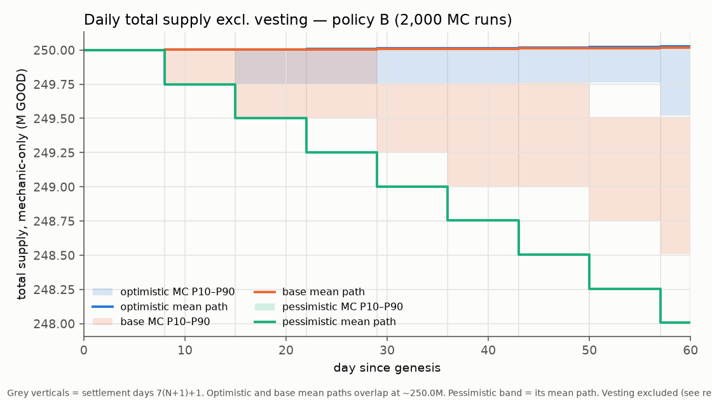

# GOODCOIN — Make Good Contagious

**A NEP-141 memecoin on NEAR whose supply reacts to the community doing good together.**
Track: **Memecoins With Mechanics** (`memecoins`) · NEAR HACKATHON 2026 · testnet · MIT

Each 7-day epoch the community must reach **both** ≥ 100 peer-verified good deeds **and** ≥ 50 unique
participants.

- **Hit both →** every counted participant can claim GOOD (25 × a streak multiplier, up to 50), 1,000
  GOOD of the public-goods treasury unlocks for community proposals, and the streak — the meme's
  high score — grows.
- **Miss either →** nothing is minted, the streak resets to 0, and **0.1% of the locked treasury burns**.

The rules live entirely in one Rust contract with **no admin key**: every parameter is fixed at launch
and readable on-chain, epochs are derived from block time, and anyone can settle them.

| | |
|---|---|
| Demo contract (minutes-long epochs, labeled `demo`) | [`goodcoin-demo-530a20.testnet`](https://testnet.nearblocks.io/address/goodcoin-demo-530a20.testnet) |
| Production-parameter contract (7-day epochs, labeled `production`) | [`goodcoin-530a20.testnet`](https://testnet.nearblocks.io/address/goodcoin-530a20.testnet) |
| Repository | https://github.com/abhirupinspace/GoodCoin |
| Web app | `web/` — run locally (see below) |
| Demo video / post | _added at submission_ |

> Accounts are not humans. GOODCOIN does **not** solve Sybil resistance; it makes farming cost real
> accounts, real attestations and public exposure, and states its limits plainly in
> [docs/SECURITY.md](docs/SECURITY.md).

---

## 1. Why a memecoin is the right tool

Memecoins already coordinate huge groups around a shared joke. Usually the only "mechanic" is price.
GOODCOIN gives the joke rules: the community has a **shared streak** it can only keep alive by doing
verifiable good things together, and a **visible cost** when it fails (the commons burns). Nobody earns
by holding; rewards go only to accounts whose deeds were approved by three independent attestors in a
week the whole community succeeded.

## 2. How it works (Proof of Good)

```
Do good ─► Submit proof ─► 3 independent attestations ─► 24h dispute window ─► counts toward the epoch
                                                                                     │
                     epoch ends + 24h ─► anyone calls settle_epochs ◄────────────────┘
                         │                                  │
            both targets met                       a target missed
   streak+1 · rewards earmarked                streak = 0 · 0.1% of locked
   1,000 GOOD treasury unlock                  treasury burned (ft_burn)
            │
   each participant calls claim_reward ─► GOOD minted (ft_mint) from the 400M reserve
```

| Mechanic | Rule (all on-chain, immutable) |
|---|---|
| Epoch | `epoch(t) = (t − genesis) / 7 days`; no admin creates epochs |
| Success | `approved_deeds ≥ 100 AND participants ≥ 50` |
| Reward | `25 GOOD × (1 + 12.5% × min(streak, 8))` per participant — breaking the streak drops everyone back to 25 |
| Failure | streak → 0, burn 0.1% of each locked treasury bucket |
| Verification | 3 distinct attestors (reviewer pool or verified contributors), no self-attestation; disputes resolved by a separate reviewer quorum |
| Treasury | 250M in 3 buckets (community 50% / environment 30% / education & OSS 20%); spendable only via one-account-one-vote proposals with quorum, threshold and caps |
| Supply | cap 1B on cumulative mint; genesis mints only the 250M treasury; 400M reward reserve + 350M vesting are unminted counters; `S(t) = S(0) + M(t) − B(t)` |

Full spec: [docs/DESIGN.md](docs/DESIGN.md) · every decision with rationale: [docs/DECISIONS.md](docs/DECISIONS.md) ·
method-by-method reference: [docs/CONTRACT.md](docs/CONTRACT.md).

## 3. Why NEAR

- **Named accounts + sub-accounts**: reviewers, organizers and vesting beneficiaries are human-readable
  accounts fixed in the config (`r0.goodcoin-team-….testnet`), so who can do what is legible on-chain.
- **Lockable contract accounts**: deleting every full-access key makes the contract provably immutable
  — the "no admin can change the rules" property is checkable by anyone with `near account list-keys`.
- **NEP-141 + NEP-297 events**: rewards and burns are standard `ft_mint` / `ft_burn` events any
  explorer or wallet understands; protocol events (`epoch_settled`, `deed_approved`, …) use the same
  standard.
- **Storage staking**: callers pay for exactly the bytes they create, so the contract cannot be filled
  for free.
- **Cheap, fast finality**: per-person claims and three-person attestations are practical.

## 4. Try it (judges: "do X → see Y")

### 4a. Read live state — no wallet, no install beyond near-cli

```sh
C=goodcoin-demo-530a20.testnet
near contract call-function as-read-only $C get_stats json-args '{}' network-config testnet now
# → current_streak, longest_streak, successful/failed epochs, current epoch window, next reward
near contract call-function as-read-only $C get_supply json-args '{}' network-config testnet now
# → max/total/circulating supply, minted, burned, reserve remaining, earmarked, unvested
near contract call-function as-read-only $C check_invariants json-args '{}' network-config testnet now
# → {"supply_equation":true,"under_cap":true,"allocations_accounted":true,"treasury_backed":true}
near contract call-function as-read-only $C list_activity json-args '{}' network-config testnet now
# → every genesis mint, reward mint, treasury unlock, failure burn and disbursement
near account list-keys $C network-config testnet now
# → no full-access keys once locked (see §7)
```

### 4b. Run the tests (≈ 1 min)

```sh
cd contract && cargo test                       # 58 unit tests: token, challenges, verification, disputes, epochs, treasury, vesting, invariants
cd ../sim && uv run pytest && uv run python -m goodsim   # simulator tests + regenerate sim/out/*
```

### 4c. Watch the whole loop happen on testnet (≈ 15 min, mostly waiting for epochs)

Requires funded testnet accounts in `~/.near-credentials` (see §6). The script asserts on chain state
after every step and prints each transaction ID:

```sh
./deploy/demo_e2e.sh goodcoin-demo-530a20.testnet goodcoin-team-530a20.testnet
```

| Step | You see |
|---|---|
| 1 | organizer creates + publishes a challenge → phase `Active` |
| 2–3 | alice/bob/carol submit deeds; r0–r2 attest → epoch shows 3/3 deeds, 3/3 participants |
| 4 | after epoch end + dispute window, anyone settles → `Succeeded`, streak 1 |
| 5 | participants claim → `ft_mint` 25 GOOD each, supply rises |
| 6 | alice proposes, bob+carol vote, anyone finalizes → `ft_transfer` from treasury to beneficiary |
| 7 | dave's deed is approved, then disputed by r3 and overturned by r4+r5 → `Rejected`, uncounted |
| 8 | next epoch misses targets → `Failed`, streak 0, longest stays 1, `ft_burn` 0.1% of locked treasury |
| 9 | `check_invariants` → all true |

### 4d. Use the web app

```sh
cd web && pnpm install && pnpm dev    # http://localhost:3000, defaults to the demo contract
```

Overview (streak, live epoch progress, supply, invariants) → Challenges → Submit (hash a local file
or fetch-and-hash a URL) → Verify (attest, dispute, re-hash evidence) → Treasury (vote, finalize) →
Activity (every mint/burn with tx links) → Leaderboard → Epochs → About (all parameters).
Connect a testnet wallet to act. See [web/README.md](web/README.md).

## 5. Economics (60-day simulation, done before choosing parameters)

`uv run python -m goodsim` — 2,000 Monte Carlo runs per scenario, deterministic seed; model mirrors the
contract rules. Full method, assumptions, charts and adversarial cases: [docs/SIMULATION.md](docs/SIMULATION.md).

| 60 days, policy B (chosen) | optimistic | base | pessimistic |
|---|---:|---:|---:|
| Successful epochs of 8 (MC mean) | 7.40 | 4.30 | 0.04 |
| Rewards minted (GOOD) | 23,433 | 8,211 | 60 |
| Burned (GOOD) | 150,585 | 923,747 | 1,982,711 |
| Final supply excl. vesting | 249.87M | 249.08M | 248.02M |

What we learned and did **not** hide:
- One failed epoch burns ~250,000 GOOD — ~91–182× what a success mints. The coin is net-deflationary
  unless the community keeps succeeding; supply moves < 1% in 60 days.
- The spec's assumed 8/6/2 successes are not reproducible at those means for any dispersion; we report
  the distribution instead of tuning it.
- Bigger rewards would raise the Sybil payoff proportionally, so we kept the spec values and added the
  capped streak multiplier (makes the streak economically real; caps per-account payoff at 50 GOOD/epoch).



## 6. Build & deploy yourself

Prereqs: Rust (toolchain pinned to 1.95.0 by `contract/rust-toolchain.toml`), `cargo-near` 0.23,
`near-cli-rs` 0.31, Python 3 + `uv`, Node 20 + pnpm.

```sh
cd contract && cargo near build non-reproducible-wasm      # → target/near/goodcoin.wasm
# testnet accounts (faucet, free):
near account create-account sponsor-by-faucet-service <team>.testnet autogenerate-new-keypair save-to-legacy-keychain network-config testnet create
near account create-account sponsor-by-faucet-service <contract>.testnet autogenerate-new-keypair save-to-legacy-keychain network-config testnet create
for n in org r0 r1 r2 r3 r4 r5 alice bob carol dave liquidity ecosystem contributors security; do
  near account create-account fund-myself $n.<team>.testnet '0.25 NEAR' autogenerate-new-keypair save-to-legacy-keychain \
    sign-as <team>.testnet network-config testnet sign-with-legacy-keychain send
done
./deploy/deploy.sh demo <contract>.testnet <team>.testnet --lock        # or: production
```

`deploy/make_config.py` holds both parameter sets; `--lock` deletes all full-access keys after init.

## 7. Immutability, security, limitations

- No owner, no setters, no upgrade method; all parameters via `get_config`.
- Deployed contracts are locked by deleting every full-access key (`deploy/deploy.sh --lock`), after
  which nobody — including the team — can change code or parameters.
- 21-item risk register, Sybil analysis and the honest limitations list: [docs/SECURITY.md](docs/SECURITY.md).
- Real-world impact is not provable on-chain: the contract proves attestations and transfers, not deeds.

## 8. Repository map

```
contract/   Rust NEAR contract (lib, token, deeds, verify, epoch, treasury, vesting, views, events, tests)
sim/        Python 60-day tokenomics simulator (+ tests, generated charts in sim/out/)
web/        Next.js app (App Router, Tailwind, near-api-js + near-connect)
deploy/     make_config.py (production/demo params), deploy.sh (deploy+init+lock), demo_e2e.sh (live E2E)
docs/       DESIGN, DECISIONS, CONTRACT, SECURITY, SIMULATION
```

## 9. Libraries, prior work and AI assistance

- Built entirely during NEAR HACKATHON (2026-11-11 → 2026-11-14). No pre-existing project code.
- Rust: `near-sdk` 5.30.1, `near-contract-standards` 5.30.1 (FungibleToken, StorageManagement, metadata, events).
- Python: numpy, matplotlib, pytest (via uv). Web: Next.js, React, Tailwind CSS, TanStack Query,
  `near-api-js`, `@hot-labs/near-connect` (exact versions in `web/package.json`).
- **AI assistance**: designed and written with Claude Code (Anthropic) under human direction, including
  the contract, tests, simulator, web app and documentation. All tests and the live E2E were run, not
  assumed.
