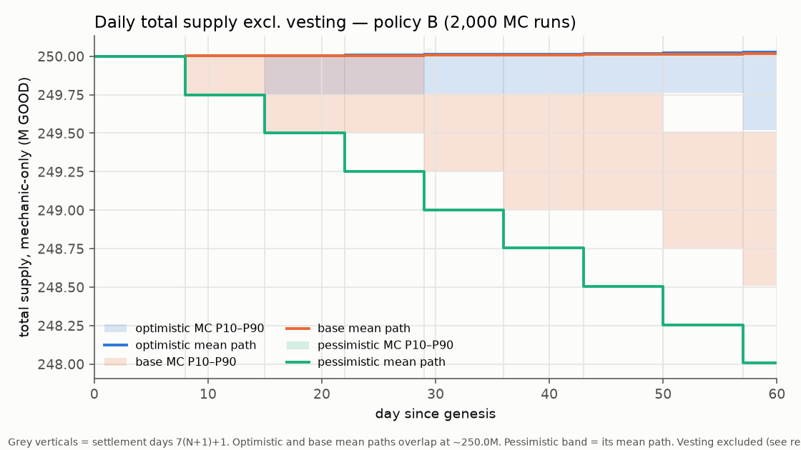
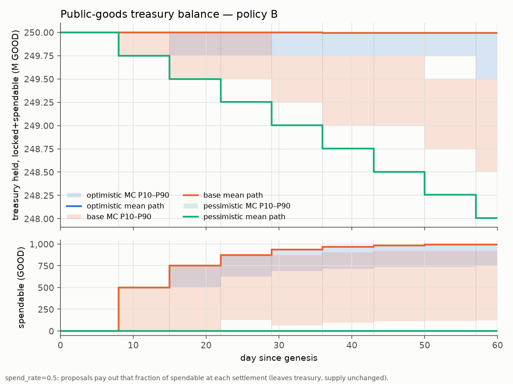
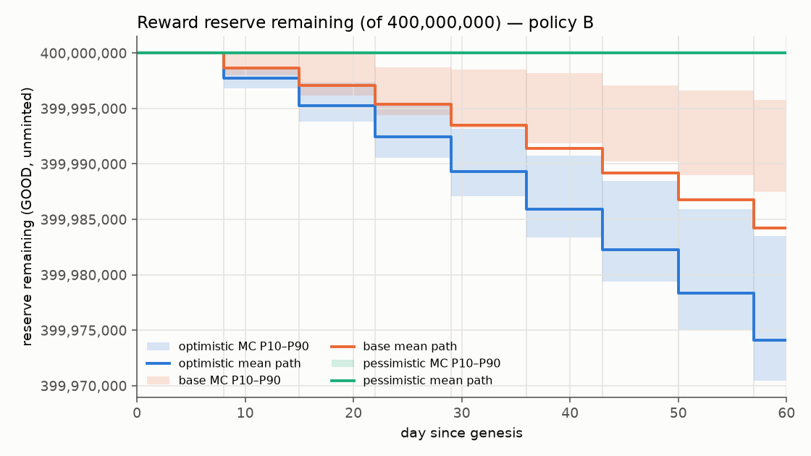
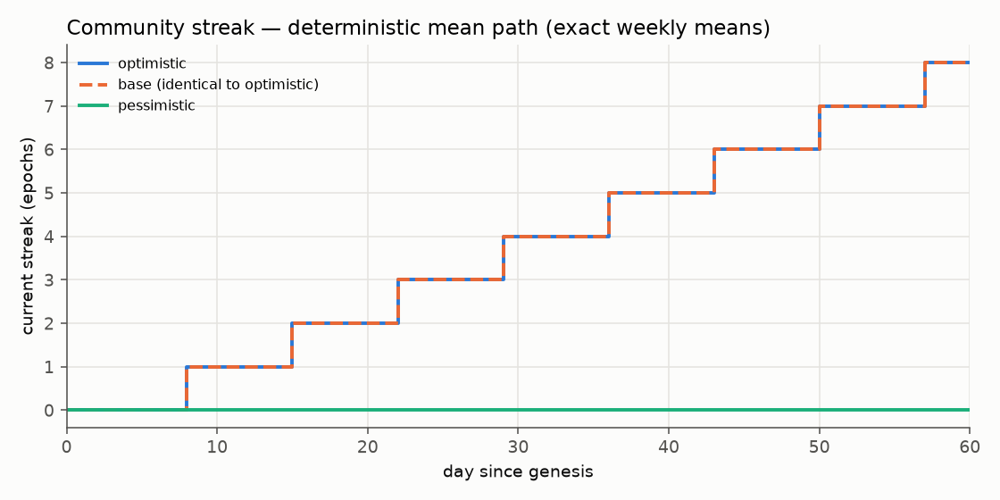
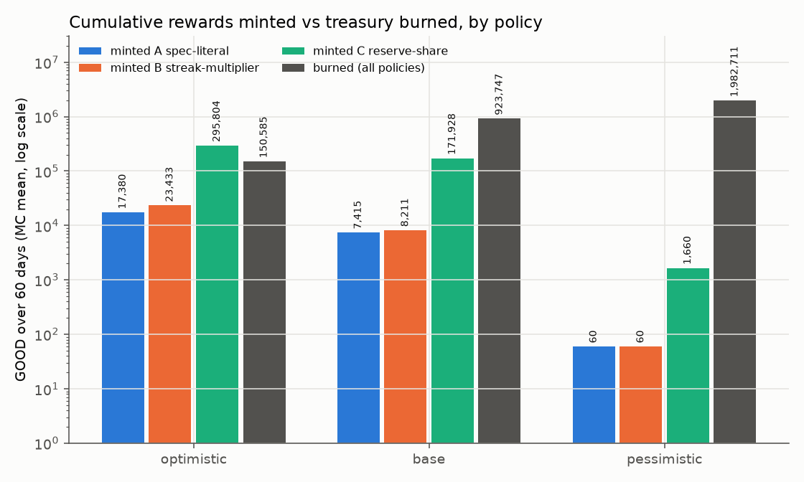

# GOODCOIN — 60-day tokenomics simulation

Source: `sim/` (Python 3.11, numpy 2.4.6, matplotlib 3.11.2, managed by `uv`). Output: `sim/out/`. Every number below is produced by the command in §1; nothing is hand-entered or tuned.

## 1. Run

```bash
cd sim
uv sync                       # install pinned deps (uv.lock)
uv run pytest                 # 24 rule + invariant tests
uv run python -m goodsim      # regenerates sim/out/* (≈6 s)
# options: --runs 2000 --seed 20261111 --k 10 --out <dir>
```

Deterministic: fixed seed (`20261111`), common random numbers across policies, PNGs saved without timestamps. Two consecutive runs produce byte-identical `sim/out/` (checked with `shasum`).

## 2. Model

### 2.1 Contract mechanics (mirrors `docs/DESIGN.md` §4–5, `docs/DECISIONS.md`)

Code: `sim/src/goodsim/contract.py`. Floats in GOOD (contract uses 24-decimal integers).

| Rule | Implementation |
|---|---|
| Genesis | 250M treasury minted to contract, locked buckets 125M/75M/50M (50/30/20); spendable 0. Reserve 400M = unminted counter. |
| Cap | `minted_total ≤ 1e9`, cumulative (burns never re-mintable). |
| Vesting (unminted, claimed daily) | Liquidity 150M/365d; Ecosystem 100M/730d; Contributors 50M, 0 before day 182, then `50M·t/730` to day 730; Security 50M/730d. |
| Epochs | 7 days; epoch N settles on day `7(N+1)+1` (1-day dispute window). Horizon 60 days → epochs 0–7 settle (days 8…57); epoch 8 unsettled. |
| Success | `approved_deeds ≥ 100 AND unique_participants ≥ 50`. |
| Reward (success) | Policy pool; if `pool ≤ reserve_remaining` earmark all and mint `claim_rate·pool` (default 1.0; unclaimed stays earmarked, unminted); else `SucceededNoReserve`, zero reward, no partial. |
| Unlock (success, incl. NoReserve) | 1,000 GOOD locked→spendable, 500/300/200 (capped at what is locked). Streak +1, longest = max. |
| Failure | streak = 0; burn 10 bps of each locked bucket. |
| Governance | each settlement, `spend_rate` (0.5) of each spendable bucket paid to beneficiaries (circulating; supply unchanged). |
| Invariants (asserted every day of every run) | `Σbalances = minted − burned`; `minted ≤ 1e9`; `reserve = remaining + earmarked`; treasury = locked + spendable; no negative balance. |

Policies:
- **A spec-literal**: 25 GOOD per participant.
- **B streak-multiplier (default, D7)**: `25·(1 + 0.125·min(streak_before, 8))` → 25, 28.125 … 50.
- **C reserve-share**: pool = 0.01% of `reserve_remaining` per success, split equally (≈40,000 GOOD/epoch).

### 2.2 Behaviour (`behavior.py`)

- Weekly participants `P ~ NegBin(mean μp, dispersion k)`, `Var = μp + μp²/k`. **k = 10 is an assumption** (moderate over-dispersion; no empirical data). §5 reports sensitivity over k ∈ [0.25, ∞).
- Deeds: each participant has `1 + Poisson(μd/μp − 1)` deeds — ≥1 because a "participant" is by definition an account with ≥1 approved deed. E[deeds | P] = P·μd/μp.
- Approval rate 1.0: spec scenario numbers are already *approved* deeds. (Code supports < 1 via per-person thinning.)
- Monte Carlo: 2,000 runs × 9 epochs per scenario. **Mean path**: every week exactly at μd, μp (deterministic).

### 2.3 Scenarios

| Scenario | Weekly means (deeds / people) | Assumption |
|---|---|---|
| optimistic / base / pessimistic | 180/90 · 110/55 · 45/25 | spec |
| spike | base, ×10 in week 4 (epoch 3) | one viral week |
| collapse | base for weeks 1–3, then 0 | community abandons |
| repeated_failures | 0 every week | deterministic 8/8 fail |
| pessimistic_ring | pessimistic + minimal Sybil top-up each failing epoch | ring adds `max(0,50−P)` sock-puppets and `max(puppets, 100−D)` fake deeds; ring has enough earned attestors (≥4, see §6) |

Analytic adversarial checks (duplicate flood, reserve stress, treasury depletion) are in `analysis.py`.

## 3. Results (policy B, `sim/out/results.md` §1)

Cell format: `mean-path · MC mean [P10–P90]`.

| Metric (GOOD unless count) | optimistic | base | pessimistic |
|---|---:|---:|---:|
| Initial minted supply | 250,000,000 | 250,000,000 | 250,000,000 |
| Final supply, mechanic-only | 250,025,875 · 249,872,848 [249,518,557–250,029,559] | 250,015,813 · 249,084,463 [248,508,126–249,512,729] | 248,006,986 · 248,017,349 [248,006,986–248,006,986] |
| Final supply, incl. vesting | 287,012,176 · 286,859,150 [286,504,858–287,015,861] | 287,002,114 · 286,070,765 [285,494,427–286,499,030] | 284,993,287 · 285,003,650 [284,993,287–284,993,287] |
| Cumulative rewards minted | 25,875 · 23,433 [16,522–29,562] | 15,812 · 8,211 [4,250–12,494] | 0 · 59.96 [0–0] |
| Treasury unlocked | 8,000 · 7,398 [6,000–8,000] | 8,000 · 4,299 [2,000–6,000] | 0 · 41.50 [0–0] |
| Treasury paid to proposals | 7,004 · 6,476 [5,520–7,004] | 7,004 · 3,769 [1,988–5,316] | 0 · 38.12 [0–0] |
| Burned | 0 · 150,585 [0–499,741] | 0 · 923,747 [499,742–1,496,243] | 1,993,014 · 1,982,711 [1,993,014–1,993,014] |
| Reserve remaining | 399,974,125 · 399,976,567 [399,970,438–399,983,478] | 399,984,188 · 399,991,789 [399,987,506–399,995,750] | 400,000,000 · 399,999,940 [400,000,000–400,000,000] |
| Treasury balance (locked+spendable) | 249,992,996 · 249,842,939 [249,495,203–249,992,996] | 249,992,996 · 249,072,484 [248,502,495–249,495,173] | 248,006,986 · 248,017,251 [248,006,986–248,006,986] |
| Successful epochs (of 8) | 8 · 7.40 [6–8] | 8 · 4.30 [2–6] | 0 · 0.04 [0–0] |
| Failed epochs | 0 · 0.60 [0–2] | 0 · 3.70 [2–6] | 8 · 7.96 [8–8] |
| SucceededNoReserve epochs | 0 · 0 [0–0] | 0 · 0 [0–0] | 0 · 0 [0–0] |
| Current streak (day 60) | 8 · 5.69 [1–8] | 8 · 1.11 [0–3] | 0 · 0.00 [0–0] |
| Longest streak | 8 · 6.62 [4–8] | 8 · 2.76 [1–5] | 0 · 0.04 [0–0] |
| Reward per rewarded participant-epoch (runs with ≥1 reward) | 35.94 · 33.43 [28.74–36.60] | 35.94 · 27.20 [25–29.93] | n/a · 25 [25–25] |
| Reserve years left (linear extrapolation) | 2,541 · 2,954 [2,224–3,980] | 4,158 · never [5,263–15,471] | never · never [never–never] |

"Reserve years left" = reserve_remaining ÷ that run's 60-day earmark rate. A mean shown as "never" means at least one run earmarked nothing.

Policy comparison, MC means (all 7 scenarios × 3 policies in `results.md` §3 and `results.csv`):

| scenario | policy | successes | rewards minted | reward/participant-epoch | burned | final supply (mech.) | reserve remaining | reserve years left |
|---|---|---:|---:|---:|---:|---:|---:|---:|
| optimistic | A spec-literal | 7.40 | 17,380 | 25 | 150,585 | 249,866,795 | 399,982,620 | 3,872 |
| optimistic | B streak-multiplier | 7.40 | 23,433 | 33.43 | 150,585 | 249,872,848 | 399,976,567 | 2,954 |
| optimistic | C reserve-share | 7.40 | 295,804 | 430 | 150,585 | 250,145,219 | 399,704,196 | never (geometric) |
| base | A spec-literal | 4.30 | 7,415 | 25 | 923,747 | 249,083,667 | 399,992,585 | never |
| base | B streak-multiplier | 4.30 | 8,211 | 27.20 | 923,747 | 249,084,463 | 399,991,789 | never |
| base | C reserve-share | 4.30 | 171,928 | 586 | 923,747 | 249,248,180 | 399,828,072 | never (geometric) |
| pessimistic | A spec-literal | 0.04 | 59.96 | 25 | 1,982,711 | 248,017,349 | 399,999,940 | never |
| pessimistic | B streak-multiplier | 0.04 | 59.96 | 25 | 1,982,711 | 248,017,349 | 399,999,940 | never |
| pessimistic | C reserve-share | 0.04 | 1,660 | 698 | 1,982,711 | 248,018,949 | 399,998,340 | never (geometric) |

## 4. Charts

1. Daily total supply, mechanic-only, policy B, P10–P90 band — 
2. Treasury balance (locked+spendable) and spendable — 
3. Reward reserve remaining — 
4. Community streak, mean path — 
5. Policy A/B/C rewards minted vs burned (log scale) — 

## 5. Spec success counts vs this model

The spec lists expected successes 8/6/2. These are treated as assumptions, not targets. At constant means, **base succeeds 8/8 and pessimistic 0/8** (mean path; pessimistic's mean of 25 people is half the target). With k = 10, Monte Carlo gives **7.40 / 4.30 / 0.04**.

Dispersion sweep (`results.md` §4): no k reproduces 8/6/2. Base is capped at 5.49 (Poisson) because per-person deed noise sometimes leaves 55 people under 100 deeds. Without that noise (deeds = ⌊P·2⌋), Poisson participants give base ≈ 6.1. That is the only configuration near the spec's 6, and it still gives pessimistic 0. Pessimistic peaks at 1.15 for k ≈ 0.5, but there optimistic falls to ≈3.6. The spec's pessimistic "2" is inconsistent with its optimistic "8" under any shared dispersion. k was not adjusted to fit.

## 6. Adversarial findings

- **Burn dominates mint.** One failure burns 250,000 GOOD. One base success mints 1,375 (A) to 2,750 (B at cap), a ratio of **182× to 91×**. Base MC: 8,211 minted vs 923,747 burned over 60 days.
- **Supply barely moves.** Worst case (all fail) is −1,993,014 GOOD (−0.80% of the treasury). Best case is +25,875 (+0.01%). Vesting adds ≈37M by day 60: ≈18× the worst-case burn and ≈1,400× the best-case mint.
- **Spike** (×10 in week 4): that epoch rewards 550 participants. There is no lasting effect; successes are limited by the other weeks (MC 4.81 vs base 4.30).
- **Collapse**: 3 successes, then 5 burns. −1.24M GOOD on the mean path.
- **Duplicate flood**: exact duplicates are rejected at submit (evidence-hash map), so they cost attestors nothing. Byte-altered duplicates need 3 rejections each: 10,000/epoch → 30,000 attestations ≈ 607 attestors at the 50/epoch cap. They cost the attacker 2,000 accounts at the 5 subs/epoch cap. **Reward impact is 0**: rejected deeds never count. The cost is reviewer attention; pending spam does not mechanically block honest attestations.
- **Fake-attestation ring (Sybil limit)**: flipping one pessimistic epoch takes **25 sock-puppets + 55 fake deeds + a ring of ≥4 earned attestors** (165 attestations). Over 8 epochs (B) the puppets extract 7,187.5 GOOD, and honest users get another 7,187.5. The ring avoids 1,993,014 GOOD of burn and unlocks 8,000 to a treasury where puppets can vote. A ring of r can approve ⌊50r/3⌋ fakes/epoch (r = 3 → ≤2,500 GOOD/epoch under B). Approved puppets become attestors, so capacity compounds. The contract is **not Sybil-resistant**: the barrier is account/storage cost (≈0.01 NEAR per submission) vs ≤50 GOOD per puppet-epoch. Under policy C the per-puppet payoff is ≈800 GOOD, 16–32× higher.
- **Reserve exhaustion** (optimistic, reward × X): B exhausts in 60 days only at X ≥ 15,459 (closed form matches) and in 10 years only at X ≥ 171. For A the thresholds are 22,222 and 341. C never exhausts: 379.7M remains after 10 years of successes.
- **Treasury depletion** (all fail): locked halves after ln 0.5 / ln 0.999 = 692.8 epochs = **13.3 years** (simulated 693).
- **Repeated failures** (60 days): 1,993,014 GOOD burned, zero minted, streak 0.

## 7. Interpretation

- At spec parameters the token is economically inert over 60 days. The visible economic event is the **burn**, which is the "failure has a cost" meme working as designed. Rewards are symbolic: 25–50 GOOD against a ≈250M supply.
- Outcomes are threshold-dominated. Base sits 10% above both targets, so ordinary week-to-week variance causes about 46% failed epochs (MC). Each failure costs ~180× a success. Pessimistic almost always burns.
- The reserve is not a binding constraint under A or B. "Reserve exhaustion" needs a reward 171× the spec to occur within 10 years.
- Policy C makes minting comparable to burning (≈40k vs 250k per epoch). It also pays more per head when fewer people participate (800 at 50 people, 444 at 90), which discourages recruiting past the target. It multiplies the Sybil payoff by 16–32×.
- Limits: behaviour is i.i.d. week to week, with no feedback from streak or rewards to participation. k is assumed. There is no token price. Disputes, rejections and governance voting are not modelled beyond `spend_rate`.

## 8. Parameter recommendation

**Keep policy B with spec values** (base 25, ×0.125 per streak epoch, cap 8, 1,000 unlock, 10 bps burn, all-or-nothing reserve). Reasons from the numbers:

1. **Spec compliance and visibility.** The 25 GOOD base is literally preserved. B adds only +11% (base: 8,211 vs 7,415) to +35% (optimistic) minted vs A, and the reserve impact is negligible (≥171× headroom over 10 years).
2. **The streak becomes economically real** at no risk. Breaking an 8-streak halves the next reward (50 → 25), which matches the "don't break the chain" meme. A makes the streak cosmetic.
3. **Bounded Sybil payoff.** At most 50 GOOD per puppet-epoch, vs ≈800 under C. Since the contract cannot prove personhood, keeping per-account payoff small is the main defence.
4. **Do not adopt C.** It is non-exhausting, but its dilution incentive and 16–32× Sybil payoff outweigh the benefit of a larger mint.
5. **Disclose rather than "fix" the inertness.** Burn ≫ mint and supply moves < 1%. Those are honest properties of the spec. Raising rewards to make charts move would raise Sybil payoff in proportion. Revisit `base_reward` only once a real price and Sybil cost exist. The parameters are immutable (D2), so any change needs a new deployment.
