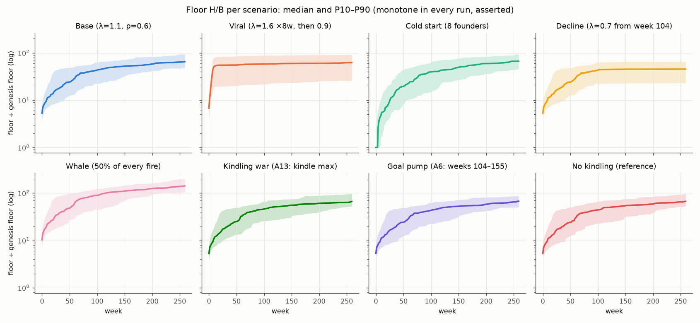
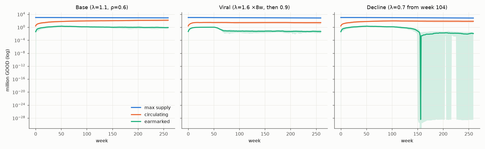
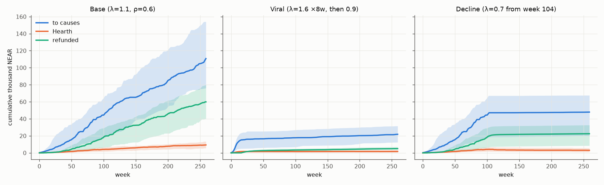
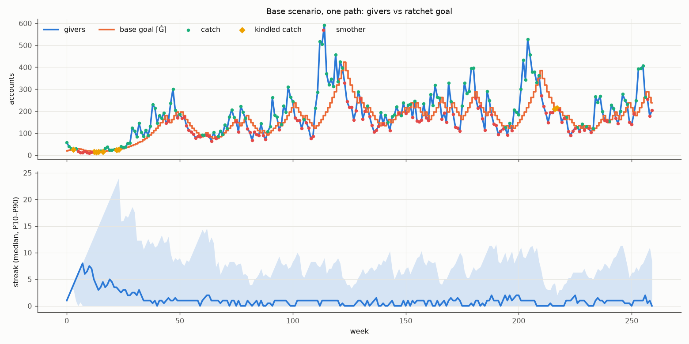
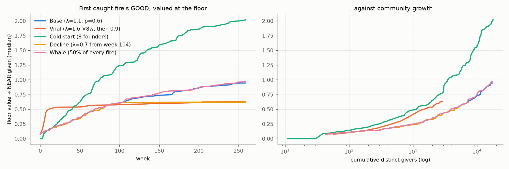
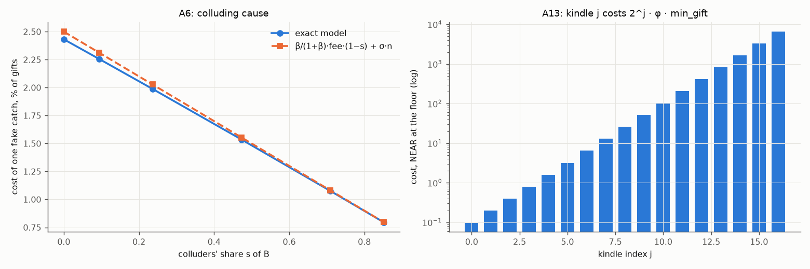
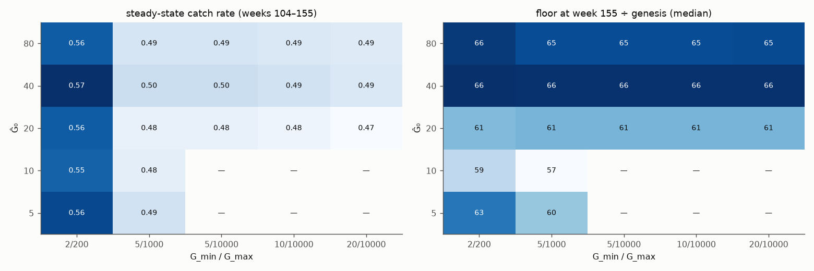
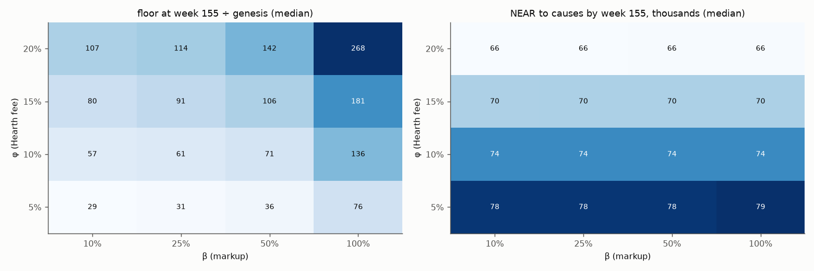
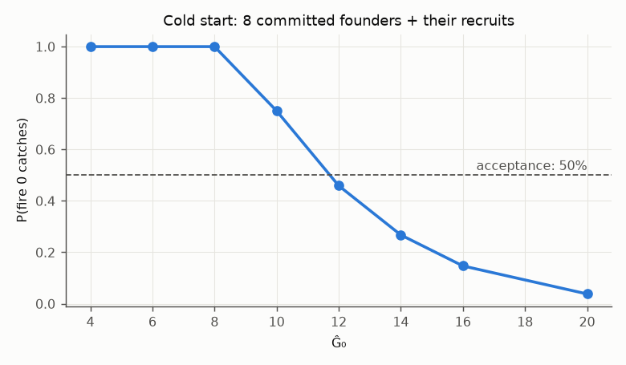

# GOODCOIN economic simulation — report

Generated by `uv run python -m goodsim` (deterministic, seed 20261113, 31.0 s). Tables: [results.md](results.md), [results.csv](results.csv). Protocol: docs/SPEC.md; plan: docs/SIMULATION.md.

## 1. Method
- **Exact protocol.** Every give, kindle, settle, payout, claim, close and redeem goes through `goodsim.protocol.Protocol`, the integer reference model (yocto units, SPEC rounding, the same code that produces `tests/golden/basic.json`). Only behaviour is sampled (numpy). After every op the model asserts SPEC §8 invariants, including the floor high-water mark `H·B* ≥ H*·B` and solvency `balance ≥ H + escrow + payouts + refunds + carry + storage`.
- **Givers.** Returning ~ Binomial(previous givers, ρ=0.6). New ~ NegBin(mean = (λ−ρ)·x·(1−x/K) + 1, k=2), x = previous givers, K = 1500. So E[next] = λ·x while small, saturating at x* = K(λ−1)/(λ−ρ) ≈ 300 for λ=1.1 (≈200 realised, because new arrivals are over-dispersed). Gift ~ LogNormal(median 2 NEAR, σ=1) truncated at `min_gift`. A newcomer names an earlier giver of the same fire as spark with p=0.5. Fire 0: all founders give plus NegBin recruits.
- **Holders.** Kindle (rational): at the rescue window the largest holder bridges the whole shortfall if allowed by SPEC (≤ max(1,⌊⌈Ĝ⌉/4⌋) short, j ≤ 16, goal ≥ 1), affordable, and `(1−s)·Σcost·F ≤ s·β/(1+β)·fee + κ·pay` with κ = 1% (altruistic value of the gifts reaching the cause). `max` mode (kindling war) kindles whenever allowed and affordable by any holder. Market premium over the floor is a reflected random walk (σ=5%/week); below 2% each holder redeems everything with p=10%. 3% of givers never claim; a keeper calls `close` 52 weeks later.
- **Horizon** 260 weeks (5 y), 4 causes, payouts always succeed in MC (dead causes/carry are covered by the golden trace and unit tests). Steady state = weeks 104–259.
- **Interpretation of λ** (ambiguity in SIMULATION §2): "new ~ NegBin(mean = λ × previous)" plus ρ=0.6 retention would grow 1.7×/week even in *Decline*; we read λ as the total growth multiplier, so the new-giver mean is (λ−ρ)·x, and add logistic saturation so Base has a steady state.

## 2. Results at a glance (SPEC production params)
- **Floor.** Base: 24× genesis after 1 y and 65× (P10–P90 48–94) after 5 y; monotone in all runs. Decline flattens it, never lowers it (45×).
- **Holder yield.** GOOD from the first caught fire is worth 0.36× its gift at the floor after 1 y and 0.95× after 5 y (Base). At claim time it is 7.6% (the allowance binds in fire 0, so below SPEC §10.3's ≈9%).
- **Causes.** Base sends 110,724 NEAR to causes over 5 y (9,311 NEAR in the Hearth, 59,896 refunded).
- **Supply.** Max supply ends at 781 M (smothers destroyed 219 M); circulating 151 M. The allowance binds in 39% of catches (48% in year 1, 30% in year 5).
- **Ratchet.** Steady-state catch rate 52.6%; goal tracks the community (mean goal 172 vs 185 givers).
- **Kindling.** Base: 4.2% of fires rescued, 0.35 M GOOD burned (0.29% of supply). Kindling war: 6.7% rescued, 6.79 M burned; floor 66× vs 65× (burns raise it). No kindling: 50.6% steady catch rate.
- **Whale** (45% of GOOD): same catch dynamics; the floor rises faster (142×) because the whale doubles every fee. Within a fire every giver, whale or not, gets the same GOOD per unit of weight, so concentration changes who holds GOOD, not the floor rule.
- **Viral** spike then λ=0.9 decays to ~10 givers/week; ratchet follows down to goal ≈11; catch rate 48% in steady state.

## 3. Acceptance criteria (SIMULATION.md §6)

| Criterion | Result |
|---|---|
| Cold start: P(fire 0) ≥ 50% with 8 founders | Ĝ₀=20 (SPEC): 2% **FAIL**; Ĝ₀=10 (recommended): 71% **PASS** |
| Base steady-state catch rate in 55–85% | SPEC params: 52.6% **FAIL**; recommended: 52.7% **FAIL** (structural, see §4) |
| Fake-catch cost reported vs s; ≥ 2% of gifts at s≈0 | 2.43% at s=0, falling to 0.80% at s=0.85 **PASS** |
| One kindle costs one gift's Hearth share; rescue frequency and burn reported | first kindle = 0.1000 NEAR at the floor = φ·min_gift **PASS**; base rescues 4.2% of fires, burning 0.29% of supply over 5 y |
| Floor never decreases in any simulated step | asserted (H·B* ≥ H*·B) after every op of every run **PASS** |

## 4. Interpretation (honest)
1. **The ratchet's fixed point is 50% unkindled catches.** With ×1.1 on an unkindled catch and ÷1.1 on a smother, the base goal settles where P(unkindled catch) = P(smother). So steady-state catch rate = 50% + ½·(rescue rate). Ĝ₀, G_min, φ and β cannot move it (sweep: every cell with a non-binding G_max sits at 47–50% in weeks 104–155). Only three things do: (a) a binding G_max (G_max=200 with ~200 givers: 56%, but it caps the goal and makes catches easy), (b) more rescues, (c) an asymmetric step. Kindle reach is capped at 17 givers and its price doubles, so with realistically noisy turnout (NegBin k=2: weekly givers swing ±25%) holders rescue only ~4% of fires even when they kindle at any price. With calm turnout (k=100) rational rescues reach 10% and the catch rate 55%.
   **The 55–85% criterion therefore fails under SPEC as written for our Base behaviour.** If the target matters, the cleanest SPEC change is a smother step of e −= 2 (fixed point P(catch) = 2/3): 66% (k=2) and 70% (k=10) in the what-if sweep. That breaks the "catch then smother returns exactly to the start" property and is a decision for the SPEC owner, not the simulator. We do not apply it.
2. **Cold start needs a lower Ĝ₀.** 8 founders plus recruits median 11 givers; P(fire 0) ≥ 50% holds for Ĝ₀ ≤ 10. Ĝ₀ = 20 gives 2%. Fire 0 cannot be kindled (nobody holds GOOD yet). A lower Ĝ₀ costs nothing later: the ratchet reaches the community size in a few dozen weeks (sweep: floor and catch rate are flat in Ĝ₀).
3. **SPEC's |e| ≤ 70 bound constrains G_max/Ĝ₀ ≤ 1.1^70 ≈ 789.** SPEC's own 20/10,000 is fine (e_max=65), but Ĝ₀ = 10 with G_max = 10,000 would need e_max = 72. Hence G_max = 5,000 (e_max = 65), still far above any simulated community.
4. **φ and β trade cause funding against holder yield; catches are unaffected.** Each +5 pp of φ costs causes ~5.5% of NEAR and raises the floor roughly in proportion to φ (φ=10%,β=25%: floor 61×, causes 74,265; φ=20%: 114×, 65,970). β moves value from new givers to existing holders without changing what causes get (β=100%: floor 136×) but makes "giving is giving" more extreme for newcomers. SPEC's 10%/25% is a reasonable middle; no evidence to move it.
5. **Attacks are priced as SPEC says.** A fake catch costs 2.43% of gifts for an outside colluder, falling linearly to 0.80% at s = 0.85 (formula within 0.1 pp; exact is slightly cheaper because new GOOD dilutes B). Sybil givers cost min_gift+σ each and 89.6% of the spend reaches the cause. Self-sparking gains exactly 0 (down to −6 yocto from rounding, minus extra σ). The goal pump raises the peak goal 322→350 and adds 1.3 smothers in the following year: with 4 rotating causes a single colluder gets one ratchet step in four weeks and honest weeks undo it.
6. **What we do not claim.** Behaviour parameters (λ, ρ, k, κ, premium) are assumptions, not data. Floor, supply and funding results are independent of the market premium except through redemptions, which never lower the floor.

## 5. Recommended SPEC §9 values

| Param | SPEC now | Recommended | Why |
|---|---|---|---|
| W | 7 d | 7 d | behaviour is modelled per week; no evidence to change |
| min_gift / σ | 1 / 0.005 NEAR | 1 / 0.005 NEAR | σ = 0.5% of a min gift; it is most of a fake catch's cost floor (σ·n) |
| φ | 10% | 10% | 90% to causes; floor ×~70 in 5 y (Base); φ=20% only buys a higher floor at causes' expense |
| β | 25% | 25% | keeps fake-catch cost ≥ 2% at s=0; higher β shifts value to early holders |
| γ | 25% | 25% | bounty moved ≈2% of fire weight; zero-sum, no attack surface (A29) |
| α | 0.25% | 0.25% | binds in 39% of catches; α=1% triples circulating supply by year 3 and cuts the floor ~3×, and each smother destroys 4× more cap; α=0.1% doubles the floor but mints <½ the GOOD per gift; no evidence to move |
| Ĝ₀ | 20 | **10** | cold start P(fire 0) 71% vs 2%; later dynamics unchanged |
| G_min | 5 | 5 | a fire of < 5 accounts is not "together"; not binding in Base |
| G_max | 10,000 | **5,000** | SPEC |e| ≤ 70 requires G_max/Ĝ₀ ≤ ~789 |
| Demo Ĝ₀/G_min/G_max | 4/2/100 | 4/2/100 | valid (e ∈ [−7, 33]); golden trace exercises all paths |

Open SPEC decision (not a parameter): accept a ~51% steady-state catch rate, or change the smother step (§4.1) to hit the 55–85% target.

## 6. Charts

## 7. Tables

Runs: 48 paths × 260 weeks per scenario; sweeps 8 paths × 156 weeks per cell; cold start 2000 fire-0 trials per Ĝ₀; seed 20261113; wall time 31.0 s. Every state transition is the exact integer model; the floor high-water mark was asserted after every op of every run.

### Scenarios (SPEC §9 production params unless marked)

| Scenario | catch rate (all) | steady catch rate (wk ≥104, P10–P90 of paths) | P(fire 0) | rescued fires | GOOD burned by kindles | floor ÷ genesis, 1 y | floor ÷ genesis, 5 y | max supply 5 y (M) | circulating 5 y (M) | NEAR to causes 5 y | week-0 GOOD value ÷ gift, 5 y |
|---|---|---|---|---|---|---|---|---|---|---|---|
| Base (λ=1.1, ρ=0.6) | 56.1% | 52.6% (49%–57%) | 100% | 4.2% | 0.35 M (0.29% of supply) | 24 (13–48) | 65 (48–94) | 781 (770–789) | 151 (72–193) | 110,724 (76,097–153,979) | 0.95 (0.67–1.43) |
| Viral (λ=1.6 ×8w, then 0.9) | 47.0% | 48.0% (42%–53%) | 100% | 9.6% | 0.10 M (0.50% of supply) | 55 (20–84) | 62 (26–91) | 721 (689–743) | 27 (8–47) | 21,810 (12,446–31,499) | 0.63 (0.35–1.03) |
| Cold start (8 founders) | 55.8% | 51.5% (46%–57%) | 2% | 4.0% | 0.40 M (0.25% of supply) | 20 (9–45) | 66 (46–94) | 781 (772–790) | 190 (85–230) | 118,722 (85,704–151,220) | 2.02 (1.32–3.45) |
| Decline (λ=0.7 from week 104) | 35.6% | 18.5% (12%–26%) | 100% | 6.5% | 0.24 M (0.49% of supply) | 24 (13–48) | 45 (23–65) | 691 (670–708) | 70 (28–118) | 47,874 (19,788–67,564) | 0.62 (0.31–0.94) |
| Whale (50% of every fire) | 57.5% | 53.8% (49%–59%) | 100% | 6.9% | 1.31 M (1.17% of supply) | 49 (27–97) | 142 (103–201) | 786 (777–796) | 163 (51–211) | 222,881 (154,267–309,682) | 0.97 (0.67–1.53) |
| Kindling war (A13: kindle max) | 57.4% | 53.8% (49%–59%) | 100% | 6.7% | 6.79 M (5.08% of supply) | 25 (13–49) | 66 (52–97) | 785 (778–795) | 157 (74–210) | 111,786 (76,223–154,396) | 0.99 (0.67–1.42) |
| Goal pump (A6: weeks 104–155) | 56.0% | 52.4% (48%–56%) | 100% | 3.9% | 0.34 M (0.28% of supply) | 24 (13–48) | 67 (50–87) | 781 (770–788) | 157 (72–212) | 110,900 (75,592–154,175) | 0.90 (0.67–1.46) |
| No kindling (reference) | 53.9% | 50.6% (46%–55%) | 100% | 0.0% | 0.00 M (0.00% of supply) | 24 (13–51) | 67 (53–97) | 772 (761–779) | 164 (65–213) | 108,590 (73,098–151,338) | 0.92 (0.61–1.62) |
| Base (λ=1.1, ρ=0.6) — recommended params | 57.4% | 52.7% (49%–57%) | 100% | 4.1% | 0.31 M (0.24% of supply) | 24 (12–49) | 65 (47–94) | 787 (780–797) | 151 (84–226) | 111,975 (76,386–156,144) | 0.92 (0.62–1.43) |
| Cold start (8 founders) — recommended params | 57.3% | 51.5% (46%–57%) | 71% | 4.2% | 0.46 M (0.36% of supply) | 19 (8–37) | 64 (45–86) | 791 (780–799) | 179 (79–230) | 118,591 (85,621–151,005) | 3.34 (2.10–6.03) |

| Scenario | givers / week (steady) | base goal (steady) | allowance binds (share of catches) | bounty weight (% of fire weight) | mean max streak | whale GOOD share | GOOD cancelled by `close` (M) |
|---|---|---|---|---|---|---|---|
| Base (λ=1.1, ρ=0.6) | 185 | 172 | 39% | 1.96% | 22.3 | 0% | 5.47 |
| Viral (λ=1.6 ×8w, then 0.9) | 10 | 11 | 7% | 2.02% | 17.9 | 0% | 1.28 |
| Cold start (8 founders) | 200 | 186 | 50% | 1.98% | 25.4 | 0% | 5.82 |
| Decline (λ=0.7 from week 104) | 6 | 17 | 32% | 2.02% | 20.2 | 0% | 3.46 |
| Whale (50% of every fire) | 186 | 175 | 37% | 0.98% | 22.0 | 45% | 5.88 |
| Kindling war (A13: kindle max) | 185 | 173 | 36% | 1.96% | 22.4 | 0% | 5.44 |
| Goal pump (A6: weeks 104–155) | 189 | 184 | 39% | 1.93% | 21.5 | 0% | 5.41 |
| No kindling (reference) | 185 | 170 | 41% | 1.98% | 21.0 | 0% | 5.35 |
| Base (λ=1.1, ρ=0.6) — recommended params | 185 | 172 | 40% | 1.95% | 26.1 | 0% | 5.67 |
| Cold start (8 founders) — recommended params | 200 | 186 | 53% | 1.97% | 26.9 | 0% | 6.25 |

### Cold start: P(fire 0 catches) with 8 committed founders

| Ĝ₀ | 4 | 6 | 8 | 10 | 12 | 14 | 16 | 20 |
|---|---|---|---|---|---|---|---|---|
| P(catch) | 100% | 100% | 100% | 75% | 46% | 27% | 15% | 4% |

Median fire-0 givers: 11 (8 founders + NegBin recruits, mean (λ−ρ)·8 = 4).

### A6 colluding cause: cost of one fake catch (exact model)

| colluders' share s of B | goal (accounts) | gifts X (NEAR) | cost (NEAR) | cost % of X | formula β/(1+β)·fee·(1−s)+σ·n |
|---|---|---|---|---|---|
| 0.00 | 43 | 43 | 1.046 | 2.43% | 1.075 (2.50%) |
| 0.09 | 43 | 43 | 0.970 | 2.25% | 0.994 (2.31%) |
| 0.24 | 43 | 43 | 0.855 | 1.99% | 0.872 (2.03%) |
| 0.47 | 43 | 43 | 0.660 | 1.54% | 0.668 (1.55%) |
| 0.71 | 43 | 43 | 0.463 | 1.08% | 0.465 (1.08%) |
| 0.85 | 43 | 43 | 0.342 | 0.80% | 0.343 (0.80%) |

Cost = NEAR in − 90% returned off-chain − change in the floor value of the colluders' GOOD.

### A7 Sybil givers (outsider, no collusion)

| fake givers G | NEAR spent | reaches cause | GOOD received, floor value | net cost | cause share of spend |
|---|---|---|---|---|---|
| 1 | 1.005 | 0.900 | 0.083 | 0.922 | 89.6% |
| 5 | 5.025 | 4.500 | 0.414 | 4.611 | 89.6% |
| 10 | 10.050 | 9.000 | 0.825 | 9.225 | 89.6% |
| 27 | 27.135 | 24.300 | 2.203 | 24.932 | 89.6% |

### A29 self-spark / account splitting (10 NEAR net, 30 honest givers)

| accounts | bounty weight moved (NEAR) | GOOD gain vs 1 account (yocto) | others' GOOD change (yocto) | extra record fees (NEAR) |
|---|---|---|---|---|
| 1 | 0.000 | 0 | 0 | 0.000 |
| 2 | 0.375 | 0 | 0 | 0.005 |
| 5 | 1.500 | -2 | 0 | 0.020 |
| 10 | 2.250 | -6 | 0 | 0.045 |

### A13 kindle price (exact GOOD at a reference state)

| j | GOOD burned | NEAR at floor | cumulative NEAR |
|---|---|---|---|
| 0 | 38,889 | 0.1 | 0.1 |
| 1 | 77,778 | 0.2 | 0.3 |
| 2 | 155,556 | 0.4 | 0.7 |
| 3 | 311,111 | 0.8 | 1.5 |
| 4 | 622,222 | 1.6 | 3.1 |
| 5 | 1,244,444 | 3.2 | 6.3 |
| 8 | 9,955,556 | 25.6 | 51.1 |
| 12 | 159,288,889 | 409.6 | 819.1 |
| 16 | 2,548,622,222 | 6,553.6 | 13,107.1 |

### Goal pump (A6): colluding cause pads its own weeks 104–155 to force unkindled catches

| metric | base | pump |
|---|---|---|
| peak base goal, weeks 104–155 | 322 | 350 |
| smothers in the 52 weeks after | 23.7 | 25.0 |
| max supply at 5 y (M) | 780.5 | 780.2 |
| NEAR to causes at 5 y | 114,909 | 114,615 |

Fake givers per path: 522 (≈ 13.0 NEAR at ≈2.5% per fake min-gift).

### Sweeps (base behaviour, 156 weeks, median of paths)

Goal parameters (`—` = invalid: G₀ outside bounds or |e| > 70):

| Ĝ₀ | G_min/G_max | catch rate | steady catch rate | floor ÷ genesis | rescued |
|---|---|---|---|---|---|
| 5 | 2/200 | 73.1% | 56.2% | 63 | 3.4% |
| 5 | 5/1000 | 62.4% | 49.3% | 60 | 4.0% |
| 10 | 2/200 | 71.0% | 55.3% | 59 | 3.5% |
| 10 | 5/1000 | 60.1% | 48.3% | 57 | 4.1% |
| 20 | 2/200 | 68.7% | 55.5% | 61 | 3.6% |
| 20 | 5/1000 | 57.3% | 48.1% | 61 | 3.3% |
| 20 | 5/10000 | 57.3% | 48.1% | 61 | 3.3% |
| 20 | 10/10000 | 57.2% | 47.8% | 61 | 3.2% |
| 20 | 20/10000 | 56.7% | 47.4% | 61 | 3.0% |
| 40 | 2/200 | 68.1% | 57.2% | 66 | 4.2% |
| 40 | 5/1000 | 55.6% | 49.5% | 66 | 4.3% |
| 40 | 5/10000 | 55.6% | 49.5% | 66 | 4.3% |
| 40 | 10/10000 | 55.5% | 49.3% | 66 | 4.2% |
| 40 | 20/10000 | 55.0% | 48.8% | 66 | 4.0% |
| 80 | 2/200 | 65.1% | 55.5% | 66 | 3.4% |
| 80 | 5/1000 | 53.0% | 49.0% | 65 | 3.8% |
| 80 | 5/10000 | 53.0% | 49.0% | 65 | 3.8% |
| 80 | 10/10000 | 53.0% | 48.8% | 65 | 3.8% |
| 80 | 20/10000 | 52.9% | 48.6% | 65 | 4.1% |

Hearth fee φ × markup β:

| φ | β | floor ÷ genesis | floor growth after fire 0 | NEAR to causes | catch rate |
|---|---|---|---|---|---|
| 5% | 10% | 29 | 9.0× | 78,340 | 57.6% |
| 5% | 25% | 31 | 9.7× | 78,340 | 57.6% |
| 5% | 50% | 36 | 11.7× | 78,340 | 57.6% |
| 5% | 100% | 76 | 22.2× | 78,640 | 57.7% |
| 10% | 10% | 57 | 8.5× | 74,259 | 57.3% |
| 10% | 25% | 61 | 9.2× | 74,265 | 57.3% |
| 10% | 50% | 71 | 11.2× | 74,265 | 57.3% |
| 10% | 100% | 136 | 21.8× | 74,265 | 57.3% |
| 15% | 10% | 80 | 8.7× | 70,093 | 56.9% |
| 15% | 25% | 91 | 9.3× | 70,133 | 57.1% |
| 15% | 50% | 106 | 11.4× | 70,133 | 57.1% |
| 15% | 100% | 181 | 21.2× | 70,133 | 57.1% |
| 20% | 10% | 107 | 8.7× | 65,942 | 56.8% |
| 20% | 25% | 114 | 9.4× | 65,970 | 56.8% |
| 20% | 50% | 142 | 11.7× | 66,008 | 56.9% |
| 20% | 100% | 268 | 22.4× | 66,008 | 57.0% |

Allowance α:

| α | allowance binds | max supply (M) | circulating (M) | floor ÷ genesis |
|---|---|---|---|---|
| 0.10% | 45% | 938 | 48 | 138 |
| 0.25% | 42% | 861 | 112 | 61 |
| 0.50% | 45% | 770 | 201 | 34 |
| 1.00% | 55% | 672 | 322 | 21 |

Holder altruism κ (value of a catch per NEAR reaching the cause) and giver-count dispersion k:

| sweep | setting | steady catch rate | rescued fires |
|---|---|---|---|
| κ | 0.0 | 46.4% | 0.2% |
| κ | 0.01 | 48.1% | 3.3% |
| κ | 0.05 | 49.5% | 4.9% |
| κ | 0.2 | 49.8% | 5.1% |
| NegBin k, kindle=rational | 2 | 48.1% | 3.3% |
| NegBin k, kindle=max | 2 | 49.8% | 5.4% |
| NegBin k, kindle=rational | 10 | 54.8% | 5.1% |
| NegBin k, kindle=max | 10 | 55.3% | 6.7% |
| NegBin k, kindle=rational | 100 | 55.3% | 9.6% |
| NegBin k, kindle=max | 100 | 56.7% | 11.1% |

What-if (NOT SPEC): smother step e −= 2 instead of 1:

| NegBin k | smother step | steady catch rate | rescued |
|---|---|---|---|
| 2 | 1 | 48.1% | 3.3% |
| 2 | 2 | 66.3% | 4.6% |
| 10 | 1 | 54.8% | 5.1% |
| 10 | 2 | 69.7% | 4.2% |
| 100 | 1 | 55.3% | 9.6% |
| 100 | 2 | 68.8% | 7.1% |
