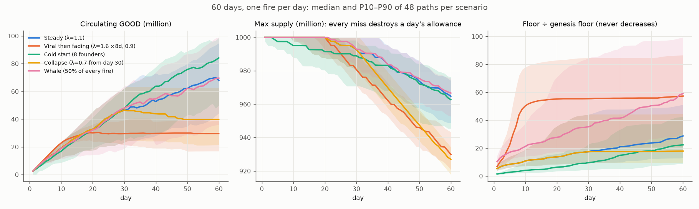

# 60-day simulation

Generated by `uv run python -m goodsim.sixty` (seed 20261113, 48 paths per scenario, 3.3 s). One fire per day, exact integer protocol model, medians across paths.

Parameters: goal_start 10, goal_min 5, goal_max 5000, min_gift 1 NEAR, fee 10%, markup 25%, allowance 0.25% of remaining supply per fire.

| Scenario | catches / 60 | longest streak | circulating day 15 / 30 / 60 (M) | max supply day 60 (M) | destroyed by misses (M) | floor ÷ genesis, day 60 | NEAR to causes |
|---|---|---|---|---|---|---|---|
| Steady (λ=1.1) | 45 | 23 | 27.14 / 46.59 / 67.89 | 964.8 | 35.2 | 28.7× | 22,928 |
| Viral then fading (λ=1.6 ×8d, 0.9) | 30 | 20 | 27.94 / 29.53 / 29.62 | 929.9 | 70.1 | 57.3× | 17,809 |
| Cold start (8 founders) | 44 | 23 | 25.36 / 47.68 / 84.14 | 962.6 | 37.4 | 22.3× | 18,208 |
| Collapse (λ=0.7 from day 30) | 28 | 21 | 27.14 / 46.59 / 39.78 | 926.9 | 73.1 | 17.8× | 8,232 |
| Whale (50% of every fire) | 46 | 23 | 25.60 / 47.96 / 69.57 | 966.6 | 33.4 | 59.0× | 46,422 |

## Picking the parameters (cold start, 8 founders, 16 paths per cell)

| goal_start | allowance per fire | P(day 1 catches) | catches / 60 | longest streak | circulating day 60 (M) | max supply day 60 (M) | floor ÷ genesis, day 60 |
|---|---|---|---|---|---|---|---|
| 5 | 0.10% | 100% | 50 | 28 | 41.5 | 990 | 63.3× |
| 5 | 0.25% | 100% | 50 | 28 | 97.9 | 976 | 27.1× |
| 5 | 1.00% | 100% | 50 | 28 | 284.3 | 921 | 9.8× |
| 10 | 0.10% | 62% | 47 | 24 | 35.8 | 987 | 67.0× |
| 10 | 0.25% | 62% | 47 | 24 | 85.9 | 969 | 28.8× |
| 10 | 1.00% | 62% | 47 | 24 | 263.5 | 895 | 10.0× |
| 20 | 0.10% | 6% | 44 | 22 | 34.5 | 984 | 68.3× |
| 20 | 0.25% | 6% | 44 | 22 | 80.4 | 961 | 29.6× |
| 20 | 1.00% | 6% | 44 | 22 | 238.2 | 865 | 10.2× |
